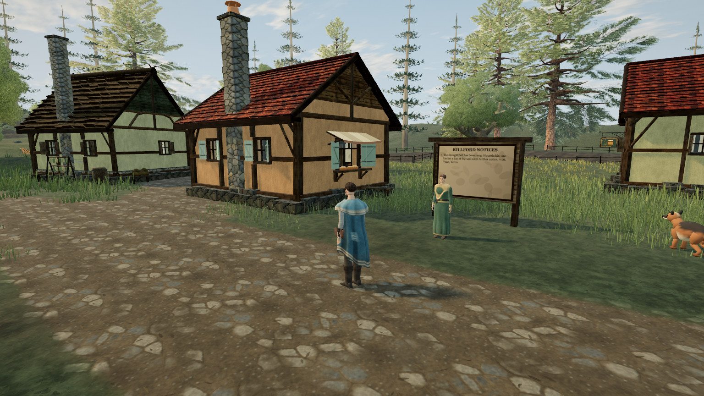
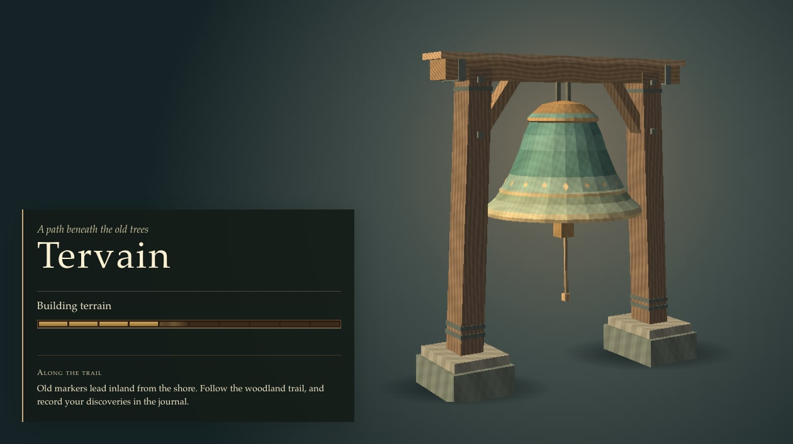

# Tervain

A single-player fantasy RPG, playable in the browser today and on its way to Unreal Engine.

**[Launch Tervain](https://0xaell.github.io/Tervain/)** · [Documentation](docs/README.md)

<p align="center">
  <a href="https://0xaell.github.io/Tervain/"></a>
</p>

You start on a grey beach with no name and no explanation, walk inland through old woodland, and reach a village that was managing fine without you. The browser build is the prototype, where the design is tried out. The destination is Unreal Engine (5.9 first, 6 when it arrives), and this repository is being reworked into the seed for that port: the game's rules and data are kept apart from the renderer so they can move.

## Status

- **Version.** The current patch is `0.1.1` in the Astra 6.2 Ultra `0.1.x` series. The title screen shows the running version. [Version policy](docs/production/versioning.md).
- **Web build.** Playable and deployed. Every merge to `main` is built, tested and published, and the published build is then loaded and played by a smoke test. It is a prototype: it still contains prototype geometry, and nothing has been measured on reference hardware.
- **Port seed.** Phase 0 of the [roadmap](docs/unreal/roadmap.md) is done: the engine-agnostic core, the exported data, the asset manifest, the porting docs and the C++ skeleton. All of it was prepared without the engine at hand. CI compiles, links and runs the skeleton against stand-ins for the engine's headers, but nothing has been built or imported in Unreal Engine yet. That is the first job of phase 1. A dated [review](docs/unreal/seed-review.md) scores each piece and says what is missing.
- **Assets.** The playable cast, animals, scenery and instruments are built from editable source. [Art and sound in 0.1.1](docs/art/valley-craft.md).
- **Not started.** A desktop package, and anything to do with a store release.

At Lantern Point the keeper’s tide bell hangs beside the tower. You see the same piece up close as you enter the valley. An original waltz, *The Ford at First Light*, opens the journey.

## What is in the prototype

Tervain is meant to be a serious RPG about a region that already has people, work, beliefs and disputes, and about earning a place in it. *Gothic 3* is the reference for how it should feel to play. The world, its people and its story are original; the [vision](docs/vision.md) and the [setting](docs/world/setting.md) say what they are meant to be.

The prototype is one small region, 580 m by 340 m: a coast, a wood, a waystation and a village. In it today:

- Buildings you can walk into, with furnished rooms and a fire in the hearth.
- Twelve named residents with a day of their own. They work a trade, sit on benches, talk, go home and sleep.
- Nineteen animals of eight kinds. Thirteen can be hunted with a bow and skinned. The cats, the dogs and the saddled deer are left alone, and the deer can be ridden.
- Sword and bow against two kinds of hostile. One is the Thornback from the teaser, without the hat.
- One water system for the sea, the streams and the spring. You can wade, swim and look under the surface.
- Grass and trees that move in one wind. The grass parts for whoever walks through it and closes behind them.
- A day and a night, adaptive music, footsteps by surface, and captioned speech.
- Inventory, equipment, a ten-slot hotbar, a journal and a map.

Not in it yet: dialogue choices. The first quest exists as rules, data and scenario tests, not as something you can play to its end.

<p align="center">
  
</p>

## Playing it

The [live build](https://0xaell.github.io/Tervain/) is published from `main` on every merge.

- Use a desktop browser with WebGL 2. There is no touch or phone layout.
- Click the view to capture the mouse. WASD moves, Shift runs, Space jumps, E interacts. Tab, M and I open the journal, the map and the inventory. Esc pauses.
- A controller works too. Keys can be rebound in Settings, and the [prototype guide](docs/engineering/prototype.md#controls) has the full table.
- Progress is saved in that browser. F5 saves and F9 loads.

## Run and build locally

You need Node 24, the version CI uses, and git.

```bash
git clone --depth 1 https://github.com/0xAell/Tervain.git
cd Tervain
npm ci
npm run dev
```

The dev server prints its address, `http://127.0.0.1:5173/`; it and `npm run preview` listen on this machine only. The working tree is more than a gigabyte of models, textures, audio and the separate study's data, hence the shallow clone.

To build the static site and serve the result:

```bash
npm run build
npm run preview
```

`npm run build` typechecks, then writes the site to `dist/`.

To check a change:

```bash
npm run check
```

It typechecks the game and the port seed, checks the exported data against the core, runs their tests and checks the commits not yet on the main branch for anything private: what CI runs on a pull request, short of the play gate, the C++ check and the study. `npm run typecheck:game` and `npm run test:game` run the typecheck and the tests alone. `npm run typecheck` and `npm test` add the separate Gothic 3 study and take much longer. After changing the core's data or the shipped assets, regenerate the exports with `npm run data:export` and `npm run assets:manifest`; CI fails when they are stale. `npm run unreal:check` confirms that the C++ skeleton still agrees with the core, and needs a C++ compiler.

`npm run perf:load -- --url http://127.0.0.1:4173/` times each stage of a journey's load in a served build; given a
second `--url`, it alternates between the two and compares their medians. `npm run perf:frame` counts where a frame's
draw calls and triangles go, pass by pass, at the benchmark route's stops. `npm run perf:programs` lists the shader
programs compiled before the first view and finds any compiled inside a draw during play.

## Repository map

| Path | What it is |
| --- | --- |
| [`src/core`](src/core/README.md) | The engine-agnostic core: the game's state, content, rules and world layout in TypeScript, with no renderer, browser or package dependency. CI enforces the boundary. This is the part a port imports or mirrors. |
| `src/presentation`, `src/app.ts`, `src/platform`, `src/physics` | The web client: the Three.js scene, interface and sound, the browser adapters for input, storage and settings, and the Rapier physics binding. It reads the core, never the other way round. |
| [`data/`](data/README.md) | The core's tables exported as JSON with schemas, the terrain as Landscape rasters, and DataTable-shaped files in Unreal's units. Generated, and checked in CI. |
| [`data/assets`](data/assets/README.md) | The asset manifest: every model, texture and sound with its source, its license, and whether a port keeps, replaces or drops it. |
| [`docs/unreal`](docs/unreal/README.md) | The porting docs: how each system maps to Unreal, the conventions, what the engine's web target can do, and a roadmap in phases. |
| [`unreal/`](unreal/README.md) | A source-only Unreal Engine 5.9 C++ skeleton that mirrors the core's data types. No binaries and no content. |
| [`docs/`](docs/README.md) | Everything else: vision, world, design, the decision register, dated engineering records and provenance ledgers. |
| `public/`, `assets/` | The files the web build serves, and the sources they were prepared from. |
| `tools/`, `tests/` | Asset pipelines and checks; unit and scenario tests. |

The [documentation index](docs/README.md) has reading paths by task. The paths of the separate Gothic 3 study are listed in [its own section](#gothic-3-study-and-reconstruction).

## Gothic 3 study and reconstruction

A separate project lives in this repository beside Tervain: a study of Gothic 3 and an incomplete TypeScript browser reconstruction of it, used as reference material for Tervain's look and feel. It shares no code with the game and is not part of the Unreal port.

- **Where it lives.** `src/gothic3` and `src/gothic3local` (code), `tools/gothic3` and `scripts/` (its tools), `tests/gothic3*` (its tests), `assets/gothic3` and `public/gothic3` (its records and prepared data), and the two pages `gothic3/` and `gothic3-local/`. Its documents are the `gothic3-*` pages under `docs/engineering` and the dated studies under `docs/art`.
- **No shared code.** No file of the game imports a file of the study, and none of the study imports the game. Only configuration names both: the site's build, because one site serves them, and the two TypeScript projects that keep them apart. `tests/tooling/gothic3Study.test.ts` fails when that stops being true.
- **Outside the port seed and its checks.** The core, the exported data, the asset manifest and the Unreal project hold nothing of it. `npm run typecheck:gothic3` and `npm run test:gothic3` are the study's; `npm run typecheck:game` and `npm run test:game` are the game's, which are also the seed's. In CI they run in separate jobs.

What it consists of:

- The [Gothic 3 / Ardea reconstruction](https://0xaell.github.io/Tervain/gothic3/) is a new browser implementation guided by the installed game. The Windows executable is not compiled into the site, and decompiled listings are not treated as original source code. Startup and campaign integration are incomplete. See its [scope and controls](docs/engineering/gothic3-browser-port.md).
- The [local-install study viewer](docs/engineering/gothic3-local.md) reads the visitor's own installed files in their browser and hosts no game data. Its page has [screenshots](docs/engineering/gothic3-local.md#screenshots).
- How the rebuilding works: a [short process guide](docs/engineering/gothic3-reconstruction-method.md), an [overview](docs/engineering/gothic3-rebuild-overview.md), a [detailed guide](docs/engineering/gothic3-rebuild-guide.md), a [workflow and repository map](docs/engineering/gothic3-rebuild-workflow.md) and a [checkpoint history](docs/engineering/gothic3-rebuilding-process.md).
- The [Gothic 3 video and Tervain visual audit](docs/art/studies/gothic3-video-2026-10-05/README.md) is a dated study with comparisons.

Neither route grants rights to Gothic 3 material or establishes commercial-release clearance. Gothic 3 is © THQ Nordic GmbH, developed by Piranha Bytes; this project is not affiliated with or endorsed by them.

## License and commercial permissions

Source-available, not open source. Eligible original Tervain software code is offered under the [PolyForm Noncommercial License 1.0.0](LICENSE), subject to the [exact scope and exceptions](LICENSE-SCOPE.md). **Commercial use of covered code requires separate permission**; [how to ask](LICENSE-SCOPE.md#commercial-permissions) is in the same document.

The license covers code only. Public access does not make the art, music, 3D models, story, branding or other non-code content freely reusable: those keep their own rights and provenance. Dependencies and separately licensed files keep their existing terms; see [NOTICE](NOTICE) and the [third-party notices](public/third-party-notices.txt). The Gothic 3 study and reconstruction material is expressly outside the grant.

For models, see the [3D asset credits and license ledger](docs/engineering/model-licenses.md), also linked from the game's About screen. A confirmed Creative Commons asset keeps its own permitted uses, including commercial ones where its license allows them; the code license does not restrict those rights. Entries with unresolved provenance are marked pending.

## Contributing

Read [CONTRIBUTING.md](CONTRIBUTING.md) and [LICENSE-SCOPE.md](LICENSE-SCOPE.md) before proposing work. Identify authorship and applicable terms for code and assets. Contributions do not transfer copyright or create blanket relicensing permission. A pull request has to pass CI and the [play gate](docs/engineering/play-gate.md).
