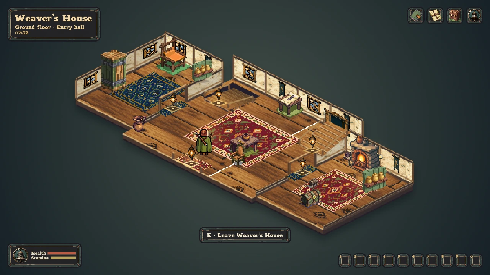

# Tervain 0.1.5 — The houses of Bellwether Vale

Follow a gold lantern into one of 22 buildings. The same lamp marks arches between rooms, stairs to another floor and the way back outdoors. The archive’s sealed entrances carry a padlock. [Play Tervain](https://0xaell.github.io/Tervain/).

- Walk into an open doorway, click its lantern, or use the interact button nearby. Indoors, the location display names your floor and room. Open the map to find the stairs.
- Explore ground-floor workshops, sleeping lofts and cellars. At the Weaver’s House you can change the hall runner at the loom. Other households offer cooking, fletching, herbal work and local records.
- Read a book to keep it in your journal, collect cupboard supplies, adjust the lights, or rest until dawn. Each household’s storage is shared across its floors.
- Save inside and return to the same room. Existing journeys continue from their saved locations.

