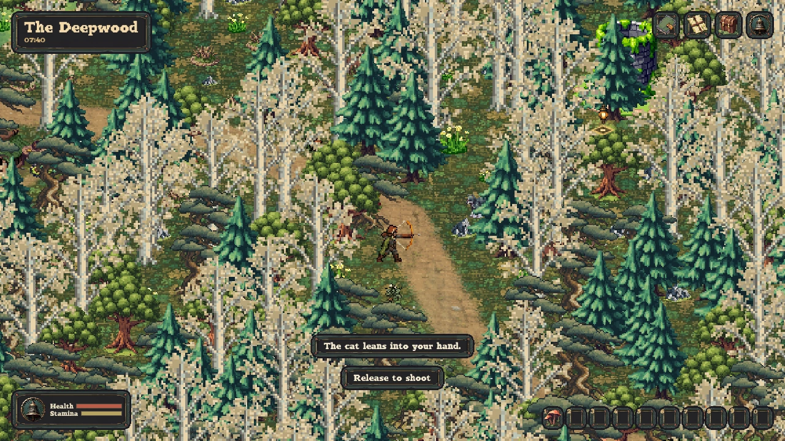

# Tervain 0.1.6 — Fieldcraft in Bellwether Vale

At the hunter’s camp, pick a field mushroom and stir it into a meal. Pack a crock for the trail or eat by the fire. In the village you can stop for a cat, greet a dog or rest on a bench. [Play Tervain](https://0xaell.github.io/Tervain/).

- Hold the right mouse button to aim, then release to shoot. Space draws in the direction you face. On a controller, hold X or the right trigger and aim with the right stick. A quick tap fires one shot.
- The ranger carries the equipped bow while walking, plants their feet to draw, holds the pose and recovers after release. The arrow flies through the scene. A wounded animal can flee and a downed animal can be harvested with the skinning knife.
- Click a pet, bench, harvestable plant or fire, or interact nearby. Cats lean into a pat and dogs wag their tails. Use the interact button to stand or move to interrupt work.
- Outdoor benches, household chairs and stools have seated poses. Hearths, worktables, books and the loom give the ranger something to do with their hands. Packed stew and gathered supplies travel with your save.

